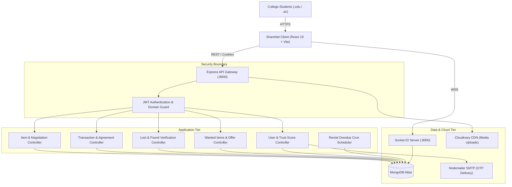
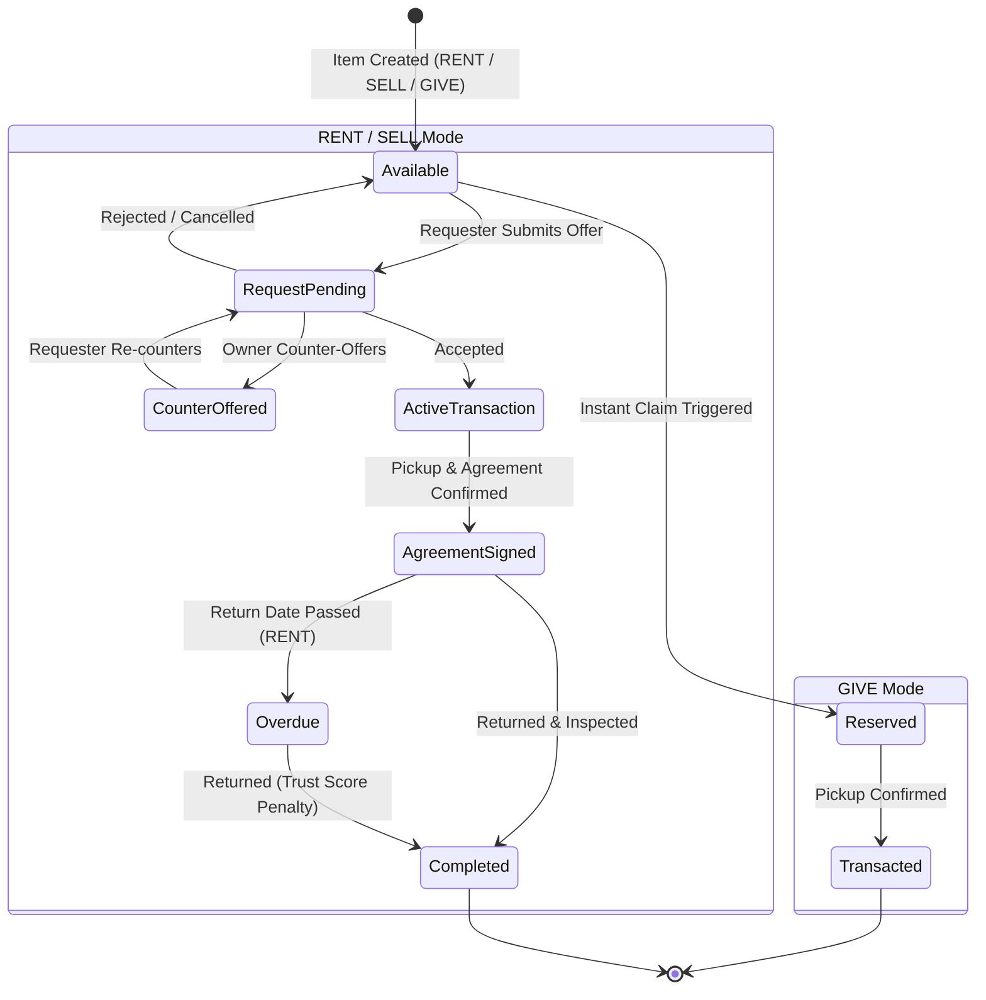

# ShareNet-Web: System & Codebase Architecture Map

> **Generated using the Enterprise AI Engineering Suite** (`.agents`)  
> **Visual Architecture & ERD Diagrams**: Generated via [Archify](file:///c:/Users/Dell/Desktop/VS%20Code/Development/ShareNet-Web/.agents/skills/archify)  
> **Date**: October 2026

---

## 1. System Topology Overview

**ShareNet** is a campus sharing economy platform designed for verified college students (`.edu` / `.ac.in` domains) to rent, sell, give away, recover lost items, and fulfill community requests in real-time.

---

## 2. Interactive Visual Architecture Artifacts

This project map includes two explorable standalone HTML visual diagrams generated via **Archify**:

| Diagram | Description | Direct File Link |
| :--- | :--- | :--- |
| **System Architecture Diagram** | Interactive architecture map showing Client Tier, Reverse Proxy, Express API, Socket.IO mesh, Background Scheduler, and Cloud Services. | [Open Architecture Diagram](file:///c:/Users/Dell/Desktop/VS%20Code/Development/ShareNet-Web/.archify/architecture-sharenet-system/sharenet-architecture.html) |
| **Database Entity-Relationship (ERD)** | Explorable relational diagram across MongoDB models, primary keys, foreign keys, and cardinalities. | [Open ERD Diagram](file:///c:/Users/Dell/Desktop/VS%20Code/Development/ShareNet-Web/.archify/erd-sharenet-database/sharenet-database.html) |

> **How to View**: Open the `.html` links above directly in any web browser to explore interactive nodes, connection tracing, dark/light themes, and search filters.

---

## 3. Directory & Component Architecture

### 3.1 Backend: [`professional-backend-structure/`](file:///c:/Users/Dell/Desktop/VS%20Code/Development/ShareNet-Web/professional-backend-structure)

Built with **Node.js**, **Express**, **MongoDB (Mongoose)**, and **Socket.IO**.

- **Core Server & Routing**:
  - [`src/index.js`](file:///c:/Users/Dell/Desktop/VS%20Code/Development/ShareNet-Web/professional-backend-structure/src/index.js): HTTP server bootstrap, DB connection, socket initialization, background reminder cron startup.
  - [`src/app.js`](file:///c:/Users/Dell/Desktop/VS%20Code/Development/ShareNet-Web/professional-backend-structure/src/app.js): Express app configuration, CORS whitelist, cookie parser, JSON body parser, and API route declarations.
  - [`src/socket.js`](file:///c:/Users/Dell/Desktop/VS%20Code/Development/ShareNet-Web/professional-backend-structure/src/socket.js): Real-time WebSocket server, JWT authentication handshake, and room multiplexing.
  - [`src/constants.js`](file:///c:/Users/Dell/Desktop/VS%20Code/Development/ShareNet-Web/professional-backend-structure/src/constants.js): Database name and shared constants.
  - [`src/db/index.js`](file:///c:/Users/Dell/Desktop/VS%20Code/Development/ShareNet-Web/professional-backend-structure/src/db/index.js): MongoDB connection handler using Mongoose.

- **Controllers ([`src/controllers/`](file:///c:/Users/Dell/Desktop/VS%20Code/Development/ShareNet-Web/professional-backend-structure/src/controllers))**:
  - [`user.controller.js`](file:///c:/Users/Dell/Desktop/VS%20Code/Development/ShareNet-Web/professional-backend-structure/src/controllers/user.controller.js): Registration, college domain verification, OTP confirmation, login, token refresh, password resets.
  - [`item.controller.js`](file:///c:/Users/Dell/Desktop/VS%20Code/Development/ShareNet-Web/professional-backend-structure/src/controllers/item.controller.js): CRUD items (`RENT`, `SELL`, `GIVE`), instant claims, counter-offer negotiations, pickup details.
  - [`request.controller.js`](file:///c:/Users/Dell/Desktop/VS%20Code/Development/ShareNet-Web/professional-backend-structure/src/controllers/request.controller.js): Item request creation, owner acceptance/rejection, counter-offer negotiation engine.
  - [`transaction.controller.js`](file:///c:/Users/Dell/Desktop/VS%20Code/Development/ShareNet-Web/professional-backend-structure/src/controllers/transaction.controller.js): Transaction lifecycles, digital agreements, return workflows, dispute handling.
  - [`lostFound.controller.js`](file:///c:/Users/Dell/Desktop/VS%20Code/Development/ShareNet-Web/professional-backend-structure/src/controllers/lostFound.controller.js): Lost & found posting, anti-fraud verification questions, claim validation, meetup coordinates.
  - [`wantedItem.controller.js`](file:///c:/Users/Dell/Desktop/VS%20Code/Development/ShareNet-Web/professional-backend-structure/src/controllers/wantedItem.controller.js): Student requests board ("Wanted Items"), community offers, status transitions.
  - [`claimChat.controller.js`](file:///c:/Users/Dell/Desktop/VS%20Code/Development/ShareNet-Web/professional-backend-structure/src/controllers/claimChat.controller.js): 1-on-1 messaging for lost & found claim investigations.
  - [`offerChat.controller.js`](file:///c:/Users/Dell/Desktop/VS%20Code/Development/ShareNet-Web/professional-backend-structure/src/controllers/offerChat.controller.js): 1-on-1 messaging for wanted item offer negotiations.
  - [`message.controller.js`](file:///c:/Users/Dell/Desktop/VS%20Code/Development/ShareNet-Web/professional-backend-structure/src/controllers/message.controller.js): Transaction-scoped messaging history.
  - [`notification.controller.js`](file:///c:/Users/Dell/Desktop/VS%20Code/Development/ShareNet-Web/professional-backend-structure/src/controllers/notification.controller.js): User notification fetching, mark read, unread counts.
  - [`trustScore.controller.js`](file:///c:/Users/Dell/Desktop/VS%20Code/Development/ShareNet-Web/professional-backend-structure/src/controllers/trustScore.controller.js): Campus reputation score calculations.

- **Models ([`src/models/`](file:///c:/Users/Dell/Desktop/VS%20Code/Development/ShareNet-Web/professional-backend-structure/src/models))**:
  - [`user.model.js`](file:///c:/Users/Dell/Desktop/VS%20Code/Development/ShareNet-Web/professional-backend-structure/src/models/user.model.js): User profile, college email domain, hashed password, refresh token, trust score [0-100].
  - [`item.model.js`](file:///c:/Users/Dell/Desktop/VS%20Code/Development/ShareNet-Web/professional-backend-structure/src/models/item.model.js): Marketplace items with modes (`RENT`, `SELL`, `GIVE`), pricing, deposit, condition, photos.
  - [`request.model.js`](file:///c:/Users/Dell/Desktop/VS%20Code/Development/ShareNet-Web/professional-backend-structure/src/models/request.model.js): Exchange inquiries with counter-offer negotiation history.
  - [`transaction.model.js`](file:///c:/Users/Dell/Desktop/VS%20Code/Development/ShareNet-Web/professional-backend-structure/src/models/transaction.model.js): Active exchanges, binding item, owner, requester, deposit, return date, status.
  - [`agreement.model.js`](file:///c:/Users/Dell/Desktop/VS%20Code/Development/ShareNet-Web/professional-backend-structure/src/models/agreement.model.js): Formal rental contract: condition on pickup vs return, return dates, signatures.
  - [`lostFound.model.js`](file:///c:/Users/Dell/Desktop/VS%20Code/Development/ShareNet-Web/professional-backend-structure/src/models/lostFound.model.js): Lost or Found notices, categories, locations, verification questions.
  - [`lostFoundClaim.model.js`](file:///c:/Users/Dell/Desktop/VS%20Code/Development/ShareNet-Web/professional-backend-structure/src/models/lostFoundClaim.model.js): Claimant answers to verification questions and proof photos.
  - [`claimChat.model.js`](file:///c:/Users/Dell/Desktop/VS%20Code/Development/ShareNet-Web/professional-backend-structure/src/models/claimChat.model.js): Real-time chat messages between finder and claimant.
  - [`wantedItem.model.js`](file:///c:/Users/Dell/Desktop/VS%20Code/Development/ShareNet-Web/professional-backend-structure/src/models/wantedItem.model.js): Community wishlist items and received offers.
  - [`offerChat.model.js`](file:///c:/Users/Dell/Desktop/VS%20Code/Development/ShareNet-Web/professional-backend-structure/src/models/offerChat.model.js): Real-time chat between poster and offerer.
  - [`otp.model.js`](file:///c:/Users/Dell/Desktop/VS%20Code/Development/ShareNet-Web/professional-backend-structure/src/models/otp.model.js): 6-digit verification code with 10-minute TTL index.
  - [`notification.model.js`](file:///c:/Users/Dell/Desktop/VS%20Code/Development/ShareNet-Web/professional-backend-structure/src/models/notification.model.js): Real-time in-app alerts and notifications.

- **Background Services**:
  - [`services/reminder.service.js`](file:///c:/Users/Dell/Desktop/VS%20Code/Development/ShareNet-Web/professional-backend-structure/src/services/reminder.service.js): Scheduled check for rental return deadlines (3-day reminders, 24h final reminders, overdue alerts).

- **Middlewares & Utilities**:
  - [`middlewares/auth.middleware.js`](file:///c:/Users/Dell/Desktop/VS%20Code/Development/ShareNet-Web/professional-backend-structure/src/middlewares/auth.middleware.js): Validates JWT Access Tokens from `Authorization` header or cookies.
  - [`middlewares/multer.middleware.js`](file:///c:/Users/Dell/Desktop/VS%20Code/Development/ShareNet-Web/professional-backend-structure/src/middlewares/multer.middleware.js): Multipart form parsing for local temporary uploads.
  - [`utils/cloudinary.js`](file:///c:/Users/Dell/Desktop/VS%20Code/Development/ShareNet-Web/professional-backend-structure/src/utils/cloudinary.js): Media pipeline uploading images to Cloudinary CDN.
  - [`utils/colleges.js`](file:///c:/Users/Dell/Desktop/VS%20Code/Development/ShareNet-Web/professional-backend-structure/src/utils/colleges.js): Whitelist validation for Indian and global academic institutions (IIITs, IITs, NITs, Universities).
  - [`utils/email.js`](file:///c:/Users/Dell/Desktop/VS%20Code/Development/ShareNet-Web/professional-backend-structure/src/utils/email.js): Nodemailer transporter sending OTP emails to college addresses.

---

### 3.2 Frontend: [`ShareNet/`](file:///c:/Users/Dell/Desktop/VS%20Code/Development/ShareNet-Web/ShareNet)

Built with **React 19**, **Vite**, **Tailwind CSS**, and **Zustand**.

- **Routing & Entry**:
  - [`src/App.jsx`](file:///c:/Users/Dell/Desktop/VS%20Code/Development/ShareNet-Web/ShareNet/src/App.jsx): Main router configuration, auth checking on boot, socket listener attachment.
  - [`src/main.jsx`](file:///c:/Users/Dell/Desktop/VS%20Code/Development/ShareNet-Web/ShareNet/src/main.jsx): React root renderer.
  - [`src/lib/axios.js`](file:///c:/Users/Dell/Desktop/VS%20Code/Development/ShareNet-Web/ShareNet/src/lib/axios.js): Preconfigured Axios instance with `withCredentials: true` and baseURL.
  - [`src/lib/socket.js`](file:///c:/Users/Dell/Desktop/VS%20Code/Development/ShareNet-Web/ShareNet/src/lib/socket.js): Socket.IO client instance singleton.

- **State Management ([`src/stores/`](file:///c:/Users/Dell/Desktop/VS%20Code/Development/ShareNet-Web/ShareNet/src/stores))**:
  - [`authStore.js`](file:///c:/Users/Dell/Desktop/VS%20Code/Development/ShareNet-Web/ShareNet/src/stores/authStore.js): Authentication state, login, register, logout, current user.
  - [`itemStore.js`](file:///c:/Users/Dell/Desktop/VS%20Code/Development/ShareNet-Web/ShareNet/src/stores/itemStore.js): Items listing, filtering, pagination, search, active item details.
  - [`requestStore.js`](file:///c:/Users/Dell/Desktop/VS%20Code/Development/ShareNet-Web/ShareNet/src/stores/requestStore.js): Incoming/outgoing requests, negotiations, counter-offers.
  - [`transactionStore.js`](file:///c:/Users/Dell/Desktop/VS%20Code/Development/ShareNet-Web/ShareNet/src/stores/transactionStore.js): Active transactions, agreements, ratings.
  - [`lostFoundStore.js`](file:///c:/Users/Dell/Desktop/VS%20Code/Development/ShareNet-Web/ShareNet/src/stores/lostFoundStore.js): Lost & found posts, verification questions, claims.
  - [`wantedItemStore.js`](file:///c:/Users/Dell/Desktop/VS%20Code/Development/ShareNet-Web/ShareNet/src/stores/wantedItemStore.js): Wanted requests board, offers received, offer statuses.
  - [`notificationStore.js`](file:///c:/Users/Dell/Desktop/VS%20Code/Development/ShareNet-Web/ShareNet/src/stores/notificationStore.js): Real-time notification badge, list, socket event handler.

- **Pages ([`src/pages/`](file:///c:/Users/Dell/Desktop/VS%20Code/Development/ShareNet-Web/ShareNet/src/pages))**:
  - [`Home.jsx`](file:///c:/Users/Dell/Desktop/VS%20Code/Development/ShareNet-Web/ShareNet/src/pages/Home.jsx): Hero section, mode explanations (`RENT`, `SELL`, `GIVE`), trending items.
  - [`Items.jsx`](file:///c:/Users/Dell/Desktop/VS%20Code/Development/ShareNet-Web/ShareNet/src/pages/Items.jsx): Filterable marketplace with category, mode, condition, and domain tabs.
  - [`ItemDetail.jsx`](file:///c:/Users/Dell/Desktop/VS%20Code/Development/ShareNet-Web/ShareNet/src/pages/ItemDetail.jsx): Item overview, instant claim trigger, request creation modal, pickup details.
  - [`CreateItem.jsx`](file:///c:/Users/Dell/Desktop/VS%20Code/Development/ShareNet-Web/ShareNet/src/pages/CreateItem.jsx) / [`EditItem.jsx`](file:///c:/Users/Dell/Desktop/VS%20Code/Development/ShareNet-Web/ShareNet/src/pages/EditItem.jsx): Item listing forms with image uploading.
  - [`Transactions.jsx`](file:///c:/Users/Dell/Desktop/VS%20Code/Development/ShareNet-Web/ShareNet/src/pages/Transactions.jsx) & [`TransactionDetail.jsx`](file:///c:/Users/Dell/Desktop/VS%20Code/Development/ShareNet-Web/ShareNet/src/pages/TransactionDetail.jsx): Transaction management, digital agreement inspection, live transaction chat.
  - [`LostFound/`](file:///c:/Users/Dell/Desktop/VS%20Code/Development/ShareNet-Web/ShareNet/src/pages/LostFound): Lost/Found post listings, verification question flow, claim submission, 1-on-1 Claim Chat.
  - [`WantedItems/`](file:///c:/Users/Dell/Desktop/VS%20Code/Development/ShareNet-Web/ShareNet/src/pages/WantedItems): Community request board, submitting offers, 1-on-1 Offer Chat.
  - [`Profile.jsx`](file:///c:/Users/Dell/Desktop/VS%20Code/Development/ShareNet-Web/ShareNet/src/pages/Profile.jsx): User statistics, college domain verification badge, trust score indicator.

---

## 4. REST API Endpoint Catalog

All routes are mounted under `/api/v1`:

### 4.1 Authentication & User Routes (`/users`)
- `POST /register`: Initial signup with college email and password; generates and emails OTP.
- `POST /verify-otp`: Confirms 6-digit OTP code, marks user as verified.
- `POST /login`: Authenticates credentials, issues HTTP-only access & refresh token cookies.
- `POST /logout`: Clears auth cookies, invalidates session token.
- `POST /refresh-token`: Renews expired access token using refresh token cookie.
- `GET /current-user`: Returns currently logged-in user profile.
- `GET /profile/:userId`: Fetches public user profile and trust score.
- `GET /trust-score/:userId`: Retrieves user trust score and history breakdown.

### 4.2 Marketplace Items (`/items`)
- `GET /`: Lists all available items with query filters (`category`, `mode`, `condition`, `search`, `collegeDomain`).
- `GET /:id`: Fetches detailed item profile including owner info.
- `POST /`: Creates a new listing (`RENT`, `SELL`, `GIVE`) with multi-image upload.
- `PUT /:id`: Updates listing details (owner only).
- `DELETE /:id`: Removes listing (owner only).
- `POST /:id/instant-claim`: Direct claim for free `GIVE` mode items without multi-step negotiations.

### 4.3 Negotiation & Requests (`/requests`)
- `POST /`: Creates an exchange request with proposed rental period / price.
- `GET /my-requests`: Inquiries submitted by the current user.
- `GET /received-requests`: Requests submitted for items owned by current user.
- `POST /:id/accept`: Owner accepts request, initializes a `Transaction`.
- `POST /:id/reject`: Owner declines request.
- `POST /:id/counter-offer`: Proposes modified pricing or rental terms.

### 4.4 Transactions & Agreements (`/transactions`)
- `GET /`: Lists active and historical transactions for user.
- `GET /:id`: Retrieves transaction details, agreement status, return timelines.
- `POST /:id/agreement`: Creates or signs digital agreement on item handover.
- `POST /:id/complete`: Marks exchange completed, releases security deposit, prompts rating.
- `POST /:id/dispute`: Flags transaction for dispute, triggers trust score penalty.

### 4.5 Lost & Found Hub (`/lost-found`)
- `GET /`: Lists active lost/found notices by category and college domain.
- `POST /`: Posts a lost/found notice with photos and anti-fraud verification questions.
- `GET /:id`: Detailed post with verification question prompts.
- `POST /:id/claim`: Submits claim with answers to verification questions and proof photo.
- `GET /:id/claims`: Owner reviews submitted claims and answers.
- `POST /claims/:claimId/accept`: Owner approves valid claimant, activates claim chat.

### 4.6 Wanted Items Community Board (`/wanted-items`)
- `GET /`: Wishlist of student items needed with budget and urgency.
- `POST /`: Creates wanted listing.
- `POST /:id/offers`: Submits an offer with price, item photo, and meetup notes.
- `POST /offers/:offerId/accept`: Poster accepts community offer, creates transaction.

---

## 5. Real-Time Socket.IO Mesh

WebSocket engine handles real-time coordination via JWT-authenticated connections in [`src/socket.js`](file:///c:/Users/Dell/Desktop/VS%20Code/Development/ShareNet-Web/professional-backend-structure/src/socket.js):

| Room Identifier | Inbound Socket Events | Outbound Broadcast Events | Purpose |
| :--- | :--- | :--- | :--- |
| `transaction:${txId}` | `join-transaction`, `send-message`, `typing`, `stop-typing`, `leave-transaction` | `new-message`, `user-typing`, `user-stop-typing` | In-transaction private buyer/seller coordination |
| `claim-chat:${chatId}` | `join-claim-chat`, `send-claim-message`, `claim-typing`, `claim-mark-read` | `new-claim-message`, `claim-user-typing`, `claim-messages-read` | 1-on-1 verification between finder and claimant |
| `offer-chat:${offerId}` | `join-offer-chat`, `offer-typing`, `offer-mark-read`, `leave-offer-chat` | `offer-messages-read`, `offer-user-typing` | 1-on-1 negotiation on wanted item offers |
| `user:${userId}` | Authenticated connection | `notification` | Direct real-time alerts (reminders, requests, claims) |

---

## 6. Core Business Workflows & State Machines

### 6.1 Marketplace Item Modes & Negotiation

### 6.2 Campus Trust Score Formula

Defined in [`src/controllers/trustScore.controller.js`](file:///c:/Users/Dell/Desktop/VS%20Code/Development/ShareNet-Web/professional-backend-structure/src/controllers/trustScore.controller.js):

$$\text{Trust Score} \in [0, 100], \quad \text{Initial Baseline} = 50$$

- **`ON_TIME_RETURN`**: $+5$ points
- **`COMPLETED` Transaction**: $+2$ points
- **`LATE_RETURN_MINOR`**: $-3$ points
- **`LATE_RETURN_MAJOR`**: $-7$ points
- **`DISPUTE` Raised**: $-10$ points

---

## 7. Integrated Enterprise AI Suite (`.agents`)

The project is now equipped with the Enterprise AI Engineering Suite cloned from `C:\Users\Dell\Desktop\VS Code\Exp`:

- [`.agents/skills/archify`](file:///c:/Users/Dell/Desktop/VS%20Code/Development/ShareNet-Web/.agents/skills/archify): Visual diagram generator for architecture, ERD, sequence, and data flow.
- [`.agents/skills/asd-ste100`](file:///c:/Users/Dell/Desktop/VS%20Code/Development/ShareNet-Web/.agents/skills/asd-ste100): Simplified Technical English validator for crystal-clear documentation.
- [`.agents/plugins/codebase-memory-mcp`](file:///c:/Users/Dell/Desktop/VS%20Code/Development/ShareNet-Web/.agents/plugins/codebase-memory-mcp): AST knowledge graph and code search MCP server across 162 languages.
- [`.agents/plugins/pstack`](file:///c:/Users/Dell/Desktop/VS%20Code/Development/ShareNet-Web/.agents/plugins/pstack): 23 engineering playbooks, TDD, and software architecture patterns.
- [`.agents/plugins/ponytail`](file:///c:/Users/Dell/Desktop/VS%20Code/Development/ShareNet-Web/.agents/plugins/ponytail): Senior developer decision ladder enforcing minimal diffs and YAGNI.
- [`.agents/plugins/trailofbits-security`](file:///c:/Users/Dell/Desktop/VS%20Code/Development/ShareNet-Web/.agents/plugins/trailofbits-security): Security differential reviews and insecure default audits.
- [`.agents/plugins/addyosmani-skills`](file:///c:/Users/Dell/Desktop/VS%20Code/Development/ShareNet-Web/.agents/plugins/addyosmani-skills): Anti-rationalization contract and STRIDE threat modeling.
