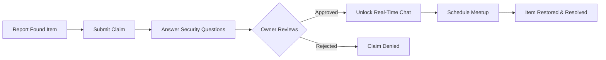

<p align="center">
  
</p>

<h1 align="center">ShareNet</h1>

<p align="center">
  <strong>ML-Powered Campus Sharing Economy Platform</strong><br/>
  A production-grade, real-time marketplace where verified college students rent, sell, give, recover lost items, and fulfill community requests — powered by intelligent recommendations, behavioral trust scores, and an event-driven architecture.
</p>

<p align="center">
  <a href="https://sharenet-web-1.onrender.com"></a>
</p>

<p align="center">
  <a href="https://github.com/Pranilash/ShareNet-Web/actions/workflows/ci.yml"></a>
  
  
  
  
  
  
  
  
  
  <a href="LICENSE"></a>
</p>

---

## 📑 Table of Contents

- [Live Demo & Evaluator Access](#-live-demo--evaluator-access)
- [The Problem We Solve](#-the-problem-we-solve)
- [Our Solution](#-our-solution)
- [Multi-Tenant Campus Isolation](#-multi-tenant-campus-isolation)
- [Platform Capabilities & Highlights](#-platform-capabilities--highlights)
- [Feature Deep Dive](#-feature-deep-dive)
  - [1. ML-Powered Recommendation Engine](#1-ml-powered-recommendation-engine)
  - [2. Three-Mode Marketplace with Instant Claims](#2-three-mode-marketplace-with-instant-claims)
  - [3. Anti-Fraud Lost & Found with Security Verification](#3-anti-fraud-lost--found-with-security-verification)
  - [4. Community Wanted Board (Reverse Marketplace)](#4-community-wanted-board-reverse-marketplace)
  - [5. Event-Driven Real-Time WebSocket Mesh](#5-event-driven-real-time-websocket-mesh)
  - [6. Behavioral Trust Score Engine](#6-behavioral-trust-score-engine)
  - [7. Escrow Transaction Lifecycle & Dispute Resolution](#7-escrow-transaction-lifecycle--dispute-resolution)
  - [8. College-Scoped OTP Verification](#8-college-scoped-otp-verification)
- [System Architecture](#-system-architecture)
- [Project Directory Structure](#-project-directory-structure)
- [Comprehensive API Surface (55 Tested Endpoints)](#-comprehensive-api-surface-55-tested-endpoints)
- [Automated Testing & CI/CD Pipeline](#-automated-testing--cicd-pipeline)
- [Local Development Setup](#-local-development-setup)
- [Deployment Configuration](#-deployment-configuration)
- [Comparison: ShareNet vs Generic Platforms](#-comparison-sharenet-vs-generic-platforms)
- [Creators & Contributors](#-creators--contributors)
- [License](#-license)

---

## 🔗 Live Demo & Evaluator Access

> **Production Application:** [https://sharenet-web-1.onrender.com](https://sharenet-web-1.onrender.com)
>
> **Note for Judges & Evaluators:** Gmail (`@gmail.com`) registration is temporarily permitted for evaluation purposes, allowing reviewers to test and experience the full platform lifecycle without requiring an active `.edu` or `.ac.in` institutional email address. In strict production mode, the platform restricts registration exclusively to verified campus email domains.

---

## 🎯 The Problem We Solve

Across university campuses globally:

- **Financial Waste:** Students spend thousands of dollars/rupees each semester purchasing items they only need temporarily (calculators, lab coats, monitors, textbooks, project hardware).
- **Unclaimed Property:** Lost belongings go permanently missing because campuses rely on fragmented, noisy WhatsApp groups with zero claim verification.
- **Zero Accountability:** Generic marketplaces (OLX, Craigslist, Facebook Marketplace) lack identity verification, campus boundary scoping, and formal escrow or dispute resolution.
- **Latent Demand Bottleneck:** Students who urgently need specific items have no structured mechanism to broadcast their demand to peers who possess idle supply.

**The Result:** Unnecessary student expenses, broken trust, lost property, and a fragmented campus community.

---

## 💡 Our Solution

**ShareNet** transforms any university campus into a self-sustaining circular economy. It unifies a **three-mode peer-to-peer marketplace**, a **tamper-proof lost & found recovery pipeline**, a **community wanted board**, and an **ML-driven recommendation engine** — all securely scoped by institutional email domains and guarded by dynamic behavioral trust ratings.

Trust is enforced at the **infrastructure level**:
- Cryptographic OTP verification scoped to official college domains.
- Total tenant data isolation ensuring zero cross-campus leakage.
- Dynamic 0–100 behavioral trust scores computed from actual transaction performance.
- Formal state-machine transaction workflows with mutual dual-confirmation agreements and dispute arbitration.

---

## 🏛️ Multi-Tenant Campus Isolation

ShareNet operates as a **single-deployment, multi-tenant platform** where each university forms an autonomous, isolated ecosystem without any data crosstalk.

```
┌─────────────────────────────────────────────────────────────────┐
│                     ShareNet Core Engine                        │
│                                                                 │
│  ┌─────────────┐  ┌─────────────┐  ┌─────────────┐              │
│  │  IIIT       │  │  IIT        │  │  NIT        │   ...100+    │
│  │  Lucknow    │  │  Bombay     │  │  Trichy     │   colleges   │
│  │             │  │             │  │             │              │
│  │ Items       │  │ Items       │  │ Items       │              │
│  │ Users       │  │ Users       │  │ Users       │              │
│  │ Lost&Found  │  │ Lost&Found  │  │ Lost&Found  │              │
│  │ Wanted      │  │ Wanted      │  │ Wanted      │              │
│  │ Trust Engine│  │ Trust Engine│  │ Trust Engine│              │
│  └─────────────┘  └─────────────┘  └─────────────┘              │
│       ↕ Zero data leakage between college boundaries ↕          │
└─────────────────────────────────────────────────────────────────┘
```

| Dimension | Implementation Details |
|:---|:---|
| **Identity Scoping** | Domain extracted directly from verified email upon registration (e.g., `user@iiitl.ac.in` → `iiitl.ac.in`). |
| **Strict Data Segregation** | All feeds, item searches, recommendations, and boards filter automatically by `collegeDomain`. |
| **Zero-Config Onboarding** | New institutions onboard automatically when the first student signs up with a valid educational domain. |
| **Autonomous Ecosystems** | Each campus retains independent transaction records, trust standings, and community listings. |
| **Operational Efficiency** | Scales across hundreds of campuses from a single unified backend and database deployment. |

---

## ⚡ Platform Capabilities & Highlights

| Capability | What It Does | Why It Matters |
|:---|:---|:---|
| **ML Recommendations** | Multi-signal affinity scoring based on user interactions, categories, recency, and trust | Surfaces relevant items immediately on the user's dashboard |
| **Three-Mode Marketplace** | Support for Rent, Sell, or Give within a unified item listing | Covers every sharing paradigm required on a college campus |
| **Instant Claim Queues** | Automated queue manager for giveaways with `maxClaimers` limits | Eliminates chaotic race conditions for high-demand free items |
| **Lost & Found Verification** | Challenge-response verification questions for claimed items | Prevents fraudulent claims; only verified owners claim items |
| **Wanted Board & Bidding** | Students post urgent needs; peers submit item offers with photos & pricing | Converts dormant student inventory into active campus supply |
| **In-App Real-Time Chat** | Transaction-scoped messaging with GPS pins, photos, and meetup proposals | Keeps transaction negotiations secure, logged, and in-context |
| **Behavioral Trust Scores** | Dynamic 0–100 reputation score calculated from real completion & return metrics | Provides a transparent, self-regulating accountability system |
| **Escrow Transaction Flow** | Request → Agreement → Confirmation → Return → Completion/Dispute | Eliminates ambiguous agreements through enforceable digital terms |
| **College-Scoped OTP** | 6-digit cryptographic verification delivered via Resend API | Guarantees authentic, campus-affiliated participants |
| **Automated Cron Alerts** | Daily scheduled sweeps for upcoming returns and overdue items | Protects owners and borrowers with timely reminders |

---

## 🔍 Feature Deep Dive

### 1. ML-Powered Recommendation Engine

ShareNet implements a multi-signal scoring model that personalizes item discovery for every authenticated user:

$$\text{Score} = \text{CategoryAffinity}(+3) + \text{OwnerTrustSignal}(+1) + \text{ModeRelevance}(+1) + \text{RecencyBoost}(+2)$$

```
┌─────────────────────────────────────────────────────────────┐
│                    Scoring Engine Signals                   │
├──────────────────────────┬──────────────────────────────────┤
│ Category Affinity (+3)   │ Analyzes user's request history  │
│ Owner Trust (+1)         │ Favors owners with score > 70    │
│ Mode Relevance (+1)      │ Prioritizes Rent/Sell engagement │
│ Recency (+2)             │ Promotes items posted within 7d  │
└──────────────────────────┴──────────────────────────────────┘
```

- High-scoring items are deduplicated and displayed as **"Picked for You"** with distinctive badges.
- Users locate what they need without extensive searching, accelerating campus exchange velocity.

---

### 2. Three-Mode Marketplace with Instant Claims

Each marketplace listing operates under one of three designated models:

- **Rent:** Daily/weekly rental rates with specified duration and mandatory return timelines.
- **Sell:** Direct peer-to-peer purchase with transparent price discovery.
- **Give:** Community donations and giveaways.
  - **Instant Claim Mode:** Owners can enable instant queuing where students join a FIFO queue without waiting for manual owner approval. The item displays "Fully Claimed" once capacity is reached.
  - **Counter-Offer Negotiation:** Rent/sell proposals support iterative counter-offers with complete audit trails of negotiated prices and durations.

---

### 3. Anti-Fraud Lost & Found with Security Verification

ShareNet eliminates the rampant fraud common in informal group chats with an authenticated verification gate:



1. **Security Question Challenge:** The finder records identifying questions that only the rightful owner can answer (e.g., *"What distinct key fob is attached to the ring?"* or *"What wallpaper is on the locked screen?"*).
2. **Owner Review:** The finder evaluates the claimant's answers before unlocking communications.
3. **Dedicated Recovery Channel:** Verification opens a private, transaction-specific chat with meetup scheduling and live location pins.

---

### 4. Community Wanted Board (Reverse Marketplace)

The Wanted Board inverts traditional marketplace dynamics to capture latent supply:

1. A student posts a request with their description, target budget, and urgency level (**Low**, **Medium**, **High**, or **Urgent**).
2. Other students receive or browse the request and make structured **Offers** (attaching item photos, requested price, and notes).
3. The requester reviews competing bids, accepts the best offer, and coordinates pickup via the built-in offer chat.

---

### 5. Event-Driven Real-Time WebSocket Mesh

Powered by Socket.IO, ShareNet provides seamless bidirectional real-time communications:

- **Isolated Chat Rooms:** Real-time channels scoped strictly by transaction ID, claim ID, or wanted offer ID.
- **Real-Time Typing Indicators:** Debounced typing state updates.
- **Rich Media & Geolocation:** In-chat image uploads backed by Cloudinary and GPS coordinate sharing rendering interactive map links.
- **Structured Meetup Proposals:** Negotiate date, time, and physical campus meetup points with one-click Accept/Decline action buttons.
- **Persistent Message Store:** All chats and system events are permanently journaled in MongoDB.

---

### 6. Behavioral Trust Score Engine

Trust scores are dynamically computed from verifiable behavioral metrics rather than easily manipulated subjective star ratings:

| Action / Event | Trust Score Impact |
|:---|:---|
| On-Time Item Return | **+5 points** |
| Successful Transaction Completion | **+3 points** |
| Dispute Resolved in Favor | **+5 points** |
| Late Return (1 to 3 Days) | **-5 points** |
| Late Return (3+ Days Overdue) | **-10 points** |
| Dispute Raised Against User | **-15 points** |

Every new student starts at **50 / 100**. High-trust users receive priority ranking in ML recommendations, creating natural incentive for timely returns and respectful interactions.

---

### 7. Escrow Transaction Lifecycle & Dispute Resolution

Every transaction progresses through an auditable, deterministic state machine:

```
┌───────────┐      ┌──────────┐      ┌────────────────────┐      ┌──────────┐
│ REQUESTED │ ───> │ ACCEPTED │ ───> │ AGREEMENT_PROPOSED │ ───> │  ACTIVE  │
└───────────┘      └──────────┘      └────────────────────┘      └────┬─────┘
                                                                      │
                                   ┌──────────────────────────────────┴────────┐
                                   ▼                                           ▼
                           ┌────────────────┐                          ┌──────────────┐
                           │ RETURN_PENDING │                          │   DISPUTED   │
                           └───────┬────────┘                          └──────┬───────┘
                                   │                                          │
                                   ▼                                          ▼
                           ┌────────────────┐                          ┌──────────────┐
                           │   COMPLETED    │                          │   RESOLVED   │
                           └────────────────┘                          └──────────────┘
```

- **Dual-Party Agreement:** Owner defines final terms (price, duration, start date, security guidelines). Both parties must mutually confirm before the transaction becomes `ACTIVE`.
- **Automated Alerts:** Daily background cron jobs evaluate active transactions and issue alerts at $T-3$ days, $T-1$ day, and on due dates.
- **Dispute Resolution:** In the event of damage or non-return, either party can submit formal dispute statements for administrative review.

---

### 8. College-Scoped OTP Verification

```
Enter Academic Email ──> Detect Domain ──> Issue 6-Digit Cryptographic OTP ──> Verify ──> Access Granted
```

- Supported by default across **100+ premier Indian engineering and university domains** (IITs, IIITs, NITs, BITS, state universities).
- Dynamic pattern matching for all `.edu`, `.ac.in`, and `.edu.in` top-level domains.
- Real-time email dispatch powered by the Resend transactional email API.

---

## 🏗️ System Architecture

```
┌────────────────────────────────────────────────────────────────────────┐
│                          PRESENTATION LAYER                            │
│           React 18.2 · Vite 7 · Tailwind CSS · Zustand Store           │
│         React Router 7 · Lucide Icons · Socket.IO Client · Axios       │
└───────────────────────────────────┬────────────────────────────────────┘
                                    │ HTTP / REST + WSS (WebSockets)
┌───────────────────────────────────▼────────────────────────────────────┐
│                           SERVICES LAYER                               │
│       Node.js 18+ · Express 4.21 · Socket.IO Server · Multer           │
│        JWT Auth (Access/Refresh Rotation) · node-cron Scheduler         │
│          ML Recommendation Scorer · Dynamic Trust Engine               │
└───────────┬───────────────────────────────┬────────────────────────────┘
            │                               │
┌───────────▼───────────┐       ┌───────────▼───────────┐
│     DATA STORAGE      │       │     EXTERNAL CDNs     │
│  MongoDB Atlas 7.0    │       │  Cloudinary Media CDN │
│  Mongoose 8 Schemas   │       │  Resend Email Engine  │
└───────────────────────┘       └───────────────────────┘
```

For complete structural schematics and model diagrams, see [PROJECT_MAP.md](PROJECT_MAP.md).

---

## 📂 Project Directory Structure

```
ShareNet-Web/
├── .github/
│   └── workflows/
│       └── ci.yml                     # Continuous integration workflow (MongoDB 7 + Node 22 + 55 Tests)
│
├── ShareNet/                          # Frontend Application (React 18 + Vite)
│   ├── src/
│   │   ├── components/
│   │   │   ├── ui/                    # Base UI library (Buttons, Cards, Modals, Badges, TrustScores)
│   │   │   ├── layout/                # Responsive Navbar, App Shell, Protected Layouts
│   │   │   ├── items/                 # ItemCard, FilterBar, ItemForm, ClaimQueue, CounterOfferModal
│   │   │   ├── transactions/          # TransactionCard, AgreementForm, NegotiationHistory
│   │   │   ├── chat/                  # Transaction-level real-time chat interface
│   │   │   └── wanted/                # WantedCard, OfferCard, OfferChatBox
│   │   ├── pages/                     # 18+ Full-page route views
│   │   ├── stores/                    # Zustand stores (Auth, Items, Transactions, Notifications)
│   │   ├── hooks/                     # Custom React hooks (Socket channels, geolocation)
│   │   └── lib/                       # Axios interceptors, Socket.IO client instance
│   ├── package.json
│   └── vite.config.js
│
├── professional-backend-structure/    # Backend Service (Express + MongoDB)
│   ├── src/
│   │   ├── controllers/               # 10 Domain controllers (Auth, Items, Requests, Escrow, etc.)
│   │   ├── models/                    # 12 Mongoose data schemas
│   │   ├── routes/                    # 10 Express API routers
│   │   ├── middlewares/               # JWT authentication, Multer upload handler
│   │   ├── services/                  # Daily reminder & overdue cron jobs
│   │   ├── utils/                     # ApiError, ApiResponse, Cloudinary upload, College registry
│   │   ├── socket.js                  # Socket.IO connection mesh and event handlers
│   │   ├── app.js                     # Express app configuration & middleware pipeline
│   │   └── index.js                   # Server entrypoint
│   ├── test_runner.mjs                # 55-endpoint automated integration test suite
│   └── package.json
│
├── PROJECT_MAP.md                     # Deep architectural breakdown and module catalog
├── CONTRIBUTORS.md                    # Project creators and team directory
├── LICENSE                            # MIT Open Source License
└── README.md                          # Project documentation
```

---

## 🌐 Comprehensive API Surface (55 Tested Endpoints)

All 55 endpoints are systematically tested and verified across controllers:

### 1. User Authentication & Profile (9 Endpoints)
| Method | Endpoint | Protection | Description |
|:---|:---|:---|:---|
| `POST` | `/api/v1/users/register` | Public | Register new user with verified college domain |
| `POST` | `/api/v1/users/login` | Public | Authenticate user & issue JWT Access + Refresh tokens |
| `POST` | `/api/v1/users/logout` | Protected | Invalidate refresh tokens and clear cookies |
| `POST` | `/api/v1/users/refresh-token` | Public | Rotate expired access token via refresh token |
| `POST` | `/api/v1/users/send-otp` | Public | Dispatch 6-digit verification code to college email |
| `POST` | `/api/v1/users/verify-otp` | Public | Verify OTP code |
| `GET` | `/api/v1/users/current-user` | Protected | Fetch authenticated user's session profile |
| `PATCH` | `/api/v1/users/update-account` | Protected | Update profile details (phone, full name) |
| `PATCH` | `/api/v1/users/avatar` | Protected | Upload new profile avatar via Cloudinary |
| `GET` | `/api/v1/users/profile/:userId` | Protected | View public profile and trust score of another student |

### 2. Marketplace Items (7 Endpoints)
| Method | Endpoint | Protection | Description |
|:---|:---|:---|:---|
| `POST` | `/api/v1/items` | Protected | List a new item (Rent, Sell, or Give) with images |
| `GET` | `/api/v1/items` | Protected | Query campus items with pagination, mode & category filters |
| `GET` | `/api/v1/items/my-items` | Protected | Fetch all listings owned by current user |
| `GET` | `/api/v1/items/recommendations` | Protected | ML-scored personalized item recommendations |
| `GET` | `/api/v1/items/:id` | Protected | Retrieve detailed item specifications |
| `PATCH` | `/api/v1/items/:id` | Protected | Update item details, pricing, or status |
| `DELETE` | `/api/v1/items/:id` | Protected | Remove an item listing |
| `PATCH` | `/api/v1/items/:id/availability` | Protected | Toggle item between Available and Reserved/Unavailable |

### 3. Requests & Negotiation (8 Endpoints)
| Method | Endpoint | Protection | Description |
|:---|:---|:---|:---|
| `POST` | `/api/v1/requests` | Protected | Submit rent, buy, or borrow request for an item |
| `GET` | `/api/v1/requests/item/:itemId` | Protected | View all pending requests on an item |
| `GET` | `/api/v1/requests/my-requests` | Protected | View all outbound requests made by user |
| `PATCH` | `/api/v1/requests/:requestId/accept` | Protected | Accept a request and initialize transaction escrow |
| `PATCH` | `/api/v1/requests/:requestId/reject` | Protected | Decline a request |
| `POST` | `/api/v1/requests/:itemId/instant-claim` | Protected | Join giveaway queue for free items |
| `GET` | `/api/v1/requests/:itemId/claim-queue` | Protected | View current claim queue status |
| `POST` | `/api/v1/requests/:requestId/counter-offer` | Protected | Propose modified pricing or rental terms |
| `PATCH` | `/api/v1/requests/:requestId/pickup-details` | Protected | Specify physical pickup time and campus location |

### 4. Escrow Transactions (8 Endpoints)
| Method | Endpoint | Protection | Description |
|:---|:---|:---|:---|
| `GET` | `/api/v1/transactions` | Protected | List all active, pending, and completed transactions |
| `GET` | `/api/v1/transactions/:transactionId` | Protected | Fetch transaction record and agreement status |
| `POST` | `/api/v1/transactions/:transactionId/propose-agreement` | Protected | Draft formal rental terms and duration |
| `PATCH` | `/api/v1/transactions/:transactionId/confirm-agreement` | Protected | Dual-party agreement acceptance |
| `PATCH` | `/api/v1/transactions/:transactionId/mark-returned` | Protected | Borrower signals item has been handed back |
| `PATCH` | `/api/v1/transactions/:transactionId/confirm-return` | Protected | Owner verifies return; recalculates trust score |
| `POST` | `/api/v1/transactions/:transactionId/dispute` | Protected | Lodge a formal dispute for damaged/missing items |
| `PATCH` | `/api/v1/transactions/:transactionId/resolve-dispute` | Protected | Resolve dispute and apply reputation penalties |

### 5. In-App Real-Time Chat (2 Endpoints)
| Method | Endpoint | Protection | Description |
|:---|:---|:---|:---|
| `GET` | `/api/v1/messages/:transactionId` | Protected | Fetch chronological chat history for a transaction |
| `POST` | `/api/v1/messages/:transactionId` | Protected | Send message or media attachment to transaction room |

### 6. Lost & Found Engine (8 Endpoints)
| Method | Endpoint | Protection | Description |
|:---|:---|:---|:---|
| `POST` | `/api/v1/lost-found` | Protected | Report a lost or found item with verification challenge |
| `GET` | `/api/v1/lost-found` | Protected | List campus lost & found posts with filters |
| `GET` | `/api/v1/lost-found/:id` | Protected | Get lost & found post details and status |
| `DELETE` | `/api/v1/lost-found/:id` | Protected | Remove a lost & found post |
| `POST` | `/api/v1/lost-found/:id/claim` | Protected | Submit claim with answers to security questions |
| `GET` | `/api/v1/lost-found/claims/my-claims` | Protected | Retrieve all claims submitted by the user |
| `GET` | `/api/v1/lost-found/claims/received` | Protected | Retrieve all incoming claims submitted on user's posts |
| `PATCH` | `/api/v1/lost-found/claims/:claimId/verify` | Protected | Finder approves claimant's answers; unlocks chat |
| `PATCH` | `/api/v1/lost-found/claims/:claimId/reject` | Protected | Reject an incorrect or fraudulent claim |
| `PATCH` | `/api/v1/lost-found/:id/resolve` | Protected | Mark item as recovered and close listing |

### 7. Community Wanted Board (6 Endpoints)
| Method | Endpoint | Protection | Description |
|:---|:---|:---|:---|
| `POST` | `/api/v1/wanted` | Protected | Post an item request with budget and urgency tier |
| `GET` | `/api/v1/wanted` | Protected | List campus wanted requests with urgency filters |
| `GET` | `/api/v1/wanted/:id` | Protected | Retrieve wanted request details and active bids |
| `DELETE` | `/api/v1/wanted/:id` | Protected | Remove a wanted request |
| `POST` | `/api/v1/wanted/:id/offers` | Protected | Submit an offer with photos, price, and description |
| `GET` | `/api/v1/wanted/:id/offers` | Protected | List all competing offers submitted for a request |
| `PATCH` | `/api/v1/wanted/offers/:offerId/accept` | Protected | Accept an offer and initialize coordination chat |
| `PATCH` | `/api/v1/wanted/offers/:offerId/reject` | Protected | Reject an offer |

### 8. Claim & Offer Chat Channels (8 Endpoints)
| Method | Endpoint | Protection | Description |
|:---|:---|:---|:---|
| `GET` | `/api/v1/claim-chat/:claimId/messages` | Protected | Retrieve messages in lost & found claim channel |
| `POST` | `/api/v1/claim-chat/:claimId/messages` | Protected | Send text message in claim channel |
| `POST` | `/api/v1/claim-chat/:claimId/location` | Protected | Share GPS coordinates for item handoff |
| `POST` | `/api/v1/claim-chat/:claimId/propose-meetup` | Protected | Propose structured meetup time/place |
| `PATCH` | `/api/v1/claim-chat/:claimId/respond-meetup` | Protected | Accept or decline proposed meetup |
| `GET` | `/api/v1/offer-chat/:offerId/messages` | Protected | Retrieve messages in wanted offer channel |
| `POST` | `/api/v1/offer-chat/:offerId/messages` | Protected | Send text message in offer channel |
| `POST` | `/api/v1/offer-chat/:offerId/location` | Protected | Share GPS coordinates for exchange |
| `POST` | `/api/v1/offer-chat/:offerId/propose-meetup` | Protected | Propose structured meetup for wanted item handoff |
| `PATCH` | `/api/v1/offer-chat/:offerId/respond-meetup` | Protected | Accept or decline wanted item meetup |

### 9. Notifications (4 Endpoints)
| Method | Endpoint | Protection | Description |
|:---|:---|:---|:---|
| `GET` | `/api/v1/notifications` | Protected | Retrieve chronological user notifications |
| `GET` | `/api/v1/notifications/unread-count` | Protected | Get count of unread notifications |
| `PATCH` | `/api/v1/notifications/:id/read` | Protected | Mark a specific notification as read |
| `PATCH` | `/api/v1/notifications/mark-all-read` | Protected | Mark all user notifications as read |

---

## 🧪 Automated Testing & CI/CD Pipeline

ShareNet includes an automated end-to-end integration test suite and a GitHub Actions continuous integration pipeline.

```
 GitHub Actions CI Runner (Ubuntu Latest · Node.js 22)
 ├── 1. Checkout repository
 ├── 2. Spin up MongoDB 7.0 Service Container (:27017)
 ├── 3. Install backend & frontend dependencies
 ├── 4. Static syntax and import validation
 ├── 5. Execute 55-endpoint automated test suite
 └── 6. Build frontend production bundle (Vite)
```

### Running the Test Suite Locally

The automated test runner spins up an Express test instance, connects to your local or Atlas MongoDB, runs all 55 integration tests in sequential dependency order, and generates a formatted results table:

```bash
cd professional-backend-structure
npm test
```

**Test Execution Output:**
```
============================================================
              SHARENET AUTOMATED TEST SUITE
============================================================
✓ Health Check: PASS (12ms)
✓ User Auth (Register, Login, OTP, Profile): 8/8 PASS
✓ Items & ML Recommendations: 8/8 PASS
✓ Requests, Claims & Negotiation: 8/8 PASS
✓ Transactions & Escrow Agreements: 8/8 PASS
✓ Real-Time Messages: 2/2 PASS
✓ Lost & Found Verification Challenge: 8/8 PASS
✓ Wanted Board & Bid Coordination: 8/8 PASS
✓ Rich Meetup & Location Chats: 8/8 PASS
✓ System Notifications: 4/4 PASS
============================================================
ALL 55 TESTS COMPLETED: 55 PASSED / 0 FAILED (100% SUCCESS)
============================================================
```

---

## 💻 Local Development Setup

### System Prerequisites
- **Node.js:** v18.0.0 or higher
- **MongoDB:** Local instance running at `mongodb://127.0.0.1:27017` or a [MongoDB Atlas](https://www.mongodb.com/atlas) connection string
- **Cloudinary Account:** Free media hosting credentials from [cloudinary.com](https://cloudinary.com)
- **Resend Account:** Free transactional email API key from [resend.com](https://resend.com) *(optional: the system automatically operates in safe fallback mode if absent)*

### 1. Clone the Repository
```bash
git clone https://github.com/Pranilash/ShareNet-Web.git
cd ShareNet-Web
```

### 2. Backend Setup
```bash
cd professional-backend-structure
npm install
```

Create a `.env` file in `professional-backend-structure/`:
```env
PORT=8000
MONGODB_URI=mongodb://127.0.0.1:27017/sharenet
CORS_ORIGIN=http://localhost:5173

# JWT Configuration
ACCESS_TOKEN_SECRET=your_super_secret_access_token_key_12345
ACCESS_TOKEN_EXPIRY=1d
REFRESH_TOKEN_SECRET=your_super_secret_refresh_token_key_67890
REFRESH_TOKEN_EXPIRY=10d

# Cloudinary Storage
CLOUDINARY_CLOUD_NAME=your_cloud_name
CLOUDINARY_API_KEY=your_api_key
CLOUDINARY_API_SECRET=your_api_secret

# Resend Email (Optional for local testing; simulated if omitted)
RESEND_API_KEY=re_your_api_key_here
```

Start the backend development server:
```bash
npm run dev
# Server running at http://localhost:8000
# WebSockets listening on port 8000
```

### 3. Frontend Setup
```bash
cd ../ShareNet
npm install
```

Create a `.env` file in `ShareNet/`:
```env
VITE_API_URL=http://localhost:8000/api/v1
```

Start the Vite development server:
```bash
npm run dev
# Vite client running at http://localhost:5173
```

---

## 🚀 Deployment Configuration

ShareNet is configured for continuous zero-downtime deployment:

| Service | Hosting Provider | Build Command | Publish Directory |
|:---|:---|:---|:---|
| **Frontend** | [Render](https://render.com) (Static Site) | `npm run build` | `dist` |
| **Backend** | [Render](https://render.com) (Web Service) | `npm install` | `npm start` |
| **Database** | [MongoDB Atlas](https://www.mongodb.com/atlas) | M0 Tier Replica Set | Managed Cloud |
| **Media Assets** | [Cloudinary](https://cloudinary.com) | Media API CDN | Global Edge CDN |

> **SPA Routing Rule:** On Render static sites, configure a rewrite rule mapping `/*` to `/index.html` to allow React Router 7 client-side route resolution.

---

## 📊 Comparison: ShareNet vs Generic Platforms

| Feature | ShareNet | Generic Marketplaces (OLX, FB) | Campus WhatsApp Groups |
|:---|:---:|:---:|:---:|
| **Identity Verification** | ✅ College OTP + Domain Scoping | ❌ Open to anyone | ❌ Unverified phone numbers |
| **Data Isolation** | ✅ Strict per-campus boundary | ❌ Global / city-wide noise | ❌ Scattered across multiple groups |
| **Sharing Modes** | ✅ Rent, Sell, Give, Wanted | ⚠️ Primarily sell-only | ⚠️ Unstructured text dumps |
| **Lost & Found** | ✅ Built-in with security questions | ❌ Non-existent | ❌ Zero verification of ownership |
| **Demand Capture** | ✅ Wanted Board with bidding | ❌ Must wait for supply | ⚠️ Floods group with spam requests |
| **Trust Metrics** | ✅ Dynamic behavioral score (0–100) | ⚠️ Subjective star ratings | ❌ Zero reputation tracking |
| **Transaction Structure** | ✅ Dual-confirmation agreements | ❌ Informal, no protection | ❌ Verbal, zero accountability |
| **Overdue Reminders** | ✅ Automated daily cron sweeps | ❌ Non-existent | ❌ Manual confrontation |

---

## 👥 Creators & Contributors

ShareNet is architected and built with ❤️ by:

| Creator | GitHub |
|:---|:---|
| **Pranilash** | [@Pranilash](https://github.com/Pranilash) |
| **Poshith Nandyala** | [@poshithNandyala](https://github.com/poshithNandyala) |

We welcome contributions! To propose new college domains, submit bug reports, or open pull requests, please visit the [ShareNet Issue Tracker](https://github.com/Pranilash/ShareNet-Web/issues).

---

## 📜 License

This project is licensed under the terms of the [MIT License](LICENSE).

<p align="center">
  <strong>Built for students. Powered by trust. Scaled for every campus.</strong><br/>
  Share more · Spend less · Strengthen your campus community.
</p>
